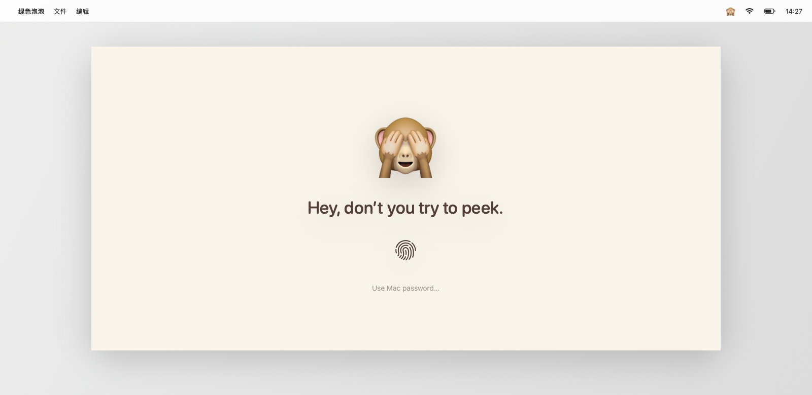

<div align="center">



# WeChat Privacy · 微信防窥

**微信静置 15 秒，自动盖上一层「别看」。**

回来按一下 Touch ID，它才让开。


[安装](#安装) · [它怎么工作](#它怎么工作) · [隐私账本](#隐私账本它到底要什么权限) · [它不做什么](#它不做什么) · [FAQ](#faq)

</div>

> **English** — A ~400-line macOS menu-bar helper that covers WeChat after 15 seconds of inactivity and reveals it behind Touch ID. It draws an opaque panel over WeChat's windows instead of modifying WeChat: no injection, no screen recording, no accessibility access, no input monitoring, no network calls. Free, MIT, macOS 14+ (Apple Silicon & Intel).

---

## 为什么会有这个

你在工位上打开微信，正在回一条不太适合被看见的消息。有人走过来。你手忙脚乱地按 `⌘H`，或者干脆把整个屏幕锁上——然后还得再解释一句"我刚才在干嘛"。

这件事的麻烦不在于"隐私"，而在于**那一眼来得太快，而你的反应总是慢半拍**。

WeChat Privacy 就是把这一下补上：你手离开键盘 15 秒，微信自己就盖住了。不用记得按什么，也不用提前准备。人走了，手指放上去，回车照打。

它服务的场景很具体：

- 工位、自习室、共享办公区、咖啡馆、地铁
- 屏幕共享 / 会议投屏，不想让聊天列表出现在画面里
- 只是离开座位去倒杯水，不想为此锁掉整台电脑

它不服务的场景也很明确：**它防的是「旁边那一眼」，不是「有备而来的人」**。这个区别后面会老实讲清楚。

## 安装

### 方式一：一行命令（推荐）

```bash
curl -fsSL https://raw.githubusercontent.com/syz-123/wechat-privacy/main/install.sh | bash
```

装到 `~/Applications`，自动处理掉 macOS 的隔离属性，装完直接启动。**不需要 sudo，不需要 Apple 开发者账号。**

脚本很短，装之前可以先读一遍：[install.sh](install.sh)。

### 方式二：下载安装包

1. 到 [Releases](https://github.com/syz-123/wechat-privacy/releases/latest) 下载 `WeChatPrivacy.zip`
2. 解压，把 `WeChat Privacy.app` 拖进「应用程序」
3. **右键点它 → 打开**（仅第一次需要右键，之后双击即可）

> **如果系统说「无法验证开发者」或「已损坏」**
> 这不是应用坏了。它是一个没有 Apple 付费公证的开源构建，macOS 对这类 App 默认拦截。任选一种放行：
> - 系统设置 → 隐私与安全性 → 往下滚 → 点「仍要打开」
> - 或者终端一行：`xattr -dr com.apple.quarantine ~/Applications/"WeChat Privacy.app"`
>
> 方式一已经替你做了这件事。

装好之后，菜单栏会出现一个 🙈。就这样，没有窗口、没有 Dock 图标、没有向导。

## 它怎么工作

| 你做的事 | 它的反应 |
| --- | --- |
| 打开 App | 菜单栏出现 🙈，微信照常用，什么都不变 |
| 微信静置 15 秒没动 | 微信窗口被盖成一张 🙈 封面 |
| 你切到别的 App | 微信窗口被**一起收起**，不会留一块奶色板子孤零零飘在别人屏幕上 |
| 你回到微信 | 封面还在，同时自动弹出 Touch ID |
| 指纹通过 | 封面撤掉，微信原样回来，焦点还在微信上 |
| 指纹失败 / 取消 | 封面留着，但**不会每隔几秒再骚扰你一次** |

三个实现上的选择，决定了它用起来"不硌人"：

**1. 覆盖，而不是注入。** 它用一层不透明的 `NSPanel` 精确贴在你的微信窗口上，尺寸跟着窗口走。微信进程完全不知道它的存在——不修改、不 hook、不读取微信的任何数据。这也是它不需要任何敏感权限的根本原因。

**2. 非激活面板。** 盖上封面的时候，微信**仍然是前台应用**，键盘焦点也没有被抢走。你按指纹，不会看到窗口闪一下、Dock 图标跳一下。这个细节很费劲，但正是"用着不烦"的关键。

**3. 系统原生 Touch ID。** 指纹控件是 macOS 自己的 `LAAuthenticationView`，指纹在 Secure Enclave 里比对，App 只拿到一个"成功 / 失败"的布尔值。它看不到你的指纹，也无法伪造你的指纹。

## 隐私账本：它到底要什么权限

一个用来保护隐私的工具，最不该做的就是顺手把隐私拿走。所以这一节是这份 README 里最重要的部分。

| 它**不**要的 | 说明 |
| --- | --- |
| ❌ 屏幕录制 | 完全不截屏。只取窗口的位置、大小、编号 |
| ❌ 辅助功能 / 输入监控 | 不读键码、不读剪贴板、不读窗口内容 |
| ❌ 网络访问 | 二进制里没有任何联网代码。可在活动监视器 → 网络里自行验证 |
| ❌ 聊天内容 | 它连"微信里有什么"都不知道 |
| ❌ 账号、登录、任何配置 | 不写任何偏好文件，删掉即干净 |

它**只读**三样东西，全部只在本机内存里用一下：

1. 当前前台 App 的 bundle id（判断"现在是微信吗"）
2. 系统最后一次键盘/鼠标事件的时间戳（判断"你 15 秒没动了"——只有时间，没有内容）
3. 窗口的位置和大小（用来把封面贴准）

判断逻辑全部是纯函数（`Session`、`OverlayPolicy`、`PromptGate`），可以用 `--self-test` 自己跑一遍验证。

## 它不做什么

诚实比营销重要。这些它做不到，写在这里免得你失望：

- **不防通知。** 系统通知横幅、通知中心里的微信预览，它管不着——那是微信自己弹在封面之外的东西。
- **不防截屏 / 录屏 / 投屏 / 远程控制。** 屏幕另一头看到的就是你屏幕上的一切。
- **不是微信官方功能。** 它不调用微信自带的"手机锁"，两者互不相干。
- **可以被强杀绕过。** 它是个普通进程，`killall` 一下就没了。所以它防的是"随手一眼"，不是"有备而来"。
- **不加密本地数据。** 微信的聊天记录在磁盘上是什么样，还是什么样。
- **只在微信窗口处于前台时覆盖。** 微信被最小化或隐藏时，它选择直接隐藏窗口，而不是留一块封面在屏幕上。
- **平台有限。** macOS 14 及以上；Windows 和手机端没有。

## FAQ

**会不会害我被微信封号？**
它不注入微信、不修改微信、不模拟任何操作、不发任何网络请求，只是在你自己桌面上画一层窗口。从微信的角度，它不存在。不过我不是腾讯，无法给出绝对保证——这一点请你自己权衡。

**为什么不上 App Store？**
App 沙盒不允许一个进程去覆盖另一个进程的窗口，这是这类工具的天然边界。它也不需要 App Store 来分发。

**15 秒能改吗？**
目前写死。克隆下来改 [`Sources/WeChatPrivacy.swift:18`](Sources/WeChatPrivacy.swift#L18) 里的 `>= 15`（顺带把第 308、321 行的提示文案一起改掉），再跑 `./build.sh` 就行。做配置界面会引入偏好存储，暂时不想为了这个破坏"删掉即干净"的性质。

**会不会很占资源？**
它每 0.15 秒查一次窗口列表，实测 CPU 占用基本为 0，常驻内存二十几 MB。没有截屏、没有轮询像素。

**重启之后还要手动打开吗？**
要。它没有注册开机自启（故意如此，避免在你不知情的时候常驻）。把 App 留在 Dock 之外的常用位置，或者自己加到「系统设置 → 通用 → 登录项」里。

**怎么彻底关掉？**
菜单栏 🙈 → `Quit WeChat Privacy…`（需要指纹确认，防止别人顺手关掉）。或者直接：

```bash
killall WeChatPrivacy
rm -rf ~/Applications/"WeChat Privacy.app"
```

它不写任何配置文件，删掉就是干净删掉。

## 从源码构建

```bash
git clone https://github.com/syz-123/wechat-privacy.git
cd wechat-privacy
./build.sh            # 默认 1.0.0 (build 10)
./build.sh 1.2.0 12   # 自定义版本号 / 构建号
```

产物在 `dist/`，同时产出可直接上传的 `dist/WeChatPrivacy-<version>.zip`。

需要 Xcode Command Line Tools（`xcode-select --install`）。构建脚本会编译 arm64 与 x86_64 两个切片并 `lipo` 合并为通用二进制，然后 ad-hoc 签名、跑一遍 `--self-test`。

自测覆盖：15 秒超时规则、前台/后台/认证中的覆盖策略、每次访问只自动弹一次指纹（取消后不会无限弹）。

## 许可证与声明

[MIT](LICENSE)。随便用、随便改、随便分发。

本项目与腾讯公司**没有任何关系**，不是官方产品，也未获其授权。名称中的 "WeChat" 仅用于说明它适用于哪款应用。

---

<div align="center">

如果它帮你少解释了一句"我刚才在干嘛"，给个 ⭐ 就好。

</div>
