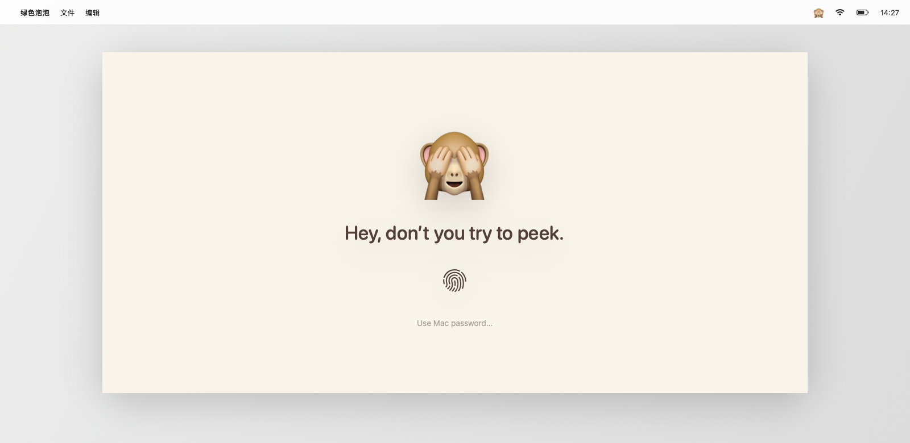

# 新手安装与使用指南

> 写给完全没用过「终端」的人。全程大概 3 分钟，一共只有 4 次点击。
> 如果哪一步和你看到的不一样，直接看文末的[出问题怎么办](#出问题怎么办)。

---

## 一、它是什么

一个躲在菜单栏里的小工具。

你打开绿色泡泡（就是那个绿色图标的聊天软件）之后，**手离开键盘和触控板 15 秒**，它的窗口会自己变成一张 🙈 的图——别人路过只能看见这张图，看不见你在聊什么。

你回来之后点一下，按一下指纹（没有指纹的可以输 Mac 密码），窗口原样还给你。



---

## 二、装之前，先确认三件事

### 1. 你的系统是不是 14 或更高

点屏幕左上角的  苹果图标 → 「关于本机」→ 看第一行的版本号。
**要 macOS 14.0 或更高**。低于 14 装不了。

### 2. 这台 Mac 是不是公司发的

公司电脑常常有安全策略，**禁止安装来路不明的软件**。如果你按下面的步骤操作，右键「打开」那一项是灰的、点不动，那就是被策略挡住了——这不是软件坏了，那台机器装不了，换一台自己的。

### 3. 有没有指纹键（Touch ID）

键盘右上角那个能按下去的方块就是。没有也能用，只是解锁那一步改成输入 Mac 密码。

---

## 三、装它（两种方式，挑一种）

### 方式一：一行命令（推荐，最快）

**第 1 步：打开「终端」**

按住 `⌘` 再按空格，会弹出一个搜索框，输入 `Terminal`，按回车。

会跳出一个窗口，里面是白底或黑底的一行行字。这个窗口叫「终端」，**不用怕它**——你只要往里粘一行字、按一次回车，就没你的事了。

**第 2 步：复制这一行**

```
curl -fsSL https://raw.githubusercontent.com/syz-123/wc-peekguard/main/install.sh | bash
```

整行都要，一个字都不能少。

**第 3 步：粘贴，回车**

回到终端窗口，按 `⌘V` 粘贴，然后按回车。

**第 4 步：等**

几秒钟后，你会看到类似这样的几行字：

```
:: downloading the latest release
:: installing to /Users/你的名字/Applications/WC PeekGuard.app
:: launching
  Installed: ...
```

**看到 `Installed:` 就成功了。** 同时屏幕右上角的菜单栏会出现一个 🙈。

> 不需要输入密码，不需要 sudo，不需要装 Xcode。
> 如果卡住超过一分钟不动，看文末的故障排查。

---

### 方式二：下载安装包（不想碰终端就走这条）

**第 1 步：下载**

打开 https://github.com/syz-123/wc-peekguard/releases/latest

找到 `WCPeekGuard.zip`，点它下载。

**第 2 步：解压、放好**

双击下载好的压缩包，会解出一个 `WC PeekGuard.app`。

把它拖进「应用程序」文件夹（在 Finder 左侧边栏能看见）。

**第 3 步：右键打开（关键）**

在「应用程序」里找到它，**用右键点它**（触控板可以两个手指同时点，或者按住 Control 再点），在弹出菜单里选「打开」。

**千万不要直接双击。** 第一次双击一定会被系统拦住，弹出「无法验证开发者」——这是正常的，不是病毒，只是因为这个软件没有买苹果的付费签名。

**第 4 步：确认一次**

系统会再问你一遍「确定要打开吗」，点「打开」。

从第二次开始，就可以正常双击了。

---

## 四、装好了吗？看这三个地方

| 看哪里 | 应该看到 |
| --- | --- |
| 屏幕右上角菜单栏 | 多了一个 🙈（可能在其他图标旁边，仔细找） |
| 点一下 🙈 | 弹出菜单：`Cover 绿色泡泡 now`、`About WC PeekGuard…`、`Quit WC PeekGuard…` |
| Dock（屏幕最下方） | **什么都没有**——它是菜单栏应用，不占 Dock，这是正常的 |

三个都对，就装好了。

---

## 五、怎么用它

**什么都不用做。**

1. 打开绿色泡泡，正常聊天
2. 手离开键盘和触控板，去干别的（接水、跟人说话、看手机）
3. 满 15 秒，窗口自己变成 🙈
4. 你回来，点一下窗口
5. 按指纹（或输 Mac 密码）

就这五步，之后每一次都自动。

想**立刻**盖住、不等 15 秒？点菜单栏的 🙈 → `Cover 绿色泡泡 now`。

---

## 六、怎么确认它真的在工作

装完别急着走，做下面 5 个小测试。**全部符合预期，说明它在正常工作。**

### 测试 1：15 秒后会盖住
打开聊天窗口，手离开键盘和触控板，**数到 15**。
✅ 窗口变成 🙈 的图
❌ 还是原样 → 看看菜单栏 🙈 还在不在，App 是不是被关掉了

### 测试 2：光动鼠标不会让它消失
盖上之后，只移动鼠标（别点击）。

✅ 还是盖着
❌ 一碰鼠标就露出来了 → 不对，请告诉我

> 这一条很重要：它设计成**必须验证身份才解开**，不是"有动作就解开"。否则你一动鼠标它就露出来了，等于没用。

### 测试 3：点一下会要指纹
✅ 弹出指纹提示（或密码框）
❌ 点了没反应 → 告诉我

### 测试 4：取消之后不会一直烦你
在第 3 步的指纹提示上按 `Esc` 取消。

✅ 还是盖着，而且接下来 20 秒内**不会再弹**指纹
❌ 每隔几秒弹一次 → 不对，请告诉我

### 测试 5：切走时窗口会整个消失
盖上之后，点一下别的 App（比如访达、浏览器）。

✅ 绿色泡泡的窗口**整个从屏幕上消失**了
❌ 屏幕上还留着一块 🙈 的板子飘着 → 不对，请告诉我

> 为什么要有这一条：如果留一块板子在那儿，反而更显眼，等于告诉所有人"这人刚才在聊什么见不得人的东西"。所以切走时必须整个收起来。

---

## 七、出问题怎么办

| 你看到的 | 大概是什么原因 | 怎么办 |
| --- | --- | --- |
| 终端卡住不动，超过 1 分钟 | 连不上 GitHub（国内常见） | 按 `Control + C` 停掉，改用方式二 |
| 出现 `curl: (55)` 或 `(56)` | 代理只给浏览器走，没管终端 | 用浏览器到 Releases 页面**同时下载 `WCPeekGuard.zip` 和 `install.sh`**，然后跑：`bash ~/Downloads/install.sh --from ~/Downloads/WCPeekGuard.zip` |
| 提示 `command not found` | 复制时漏了字符或换行了 | 回到上面重新整行复制 |
| 双击提示「已损坏，应移到废纸篓」 | 下载不完整 | 删掉，重新下载一次 |
| 双击提示「无法验证开发者」 | **正常**，没有付费签名 | 右键 → 打开（方式二第 3 步） |
| 右键菜单里「打开」是灰的 | 公司电脑的安全策略 | 这台机器装不了，换一台 |
| 菜单栏找不到 🙈 | 图标太多被挤掉了 | 菜单栏图标可以按住 ⌘ 拖动排序；或看 Dock 里有没有 |
| 装完什么都没发生 | 可能被系统拦了 | 打开「应用程序」文件夹，看 App 在不在，手动打开一次 |

---

## 八、怎么关掉、怎么删干净

**临时关掉**：点菜单栏 🙈 → `Quit WC PeekGuard…` → 按指纹确认。
（要指纹，是防止别人趁你不在顺手关掉它。）

**彻底删除**：上面退出之后，把「应用程序」里的 `WC PeekGuard.app` 拖进废纸篓。就完了。

（如果以后想用命令行删，`killall WCPeekGuard` 提示 `No matching process` 是正常的——说明它本来就没在运行。）

它**不写任何配置文件、不装开机自启、不在系统里留东西**，删掉就是干净删掉。

---

## 九、它会不会偷我的东西

三句话：

1. **它不联网。** 程序里没有一行联网代码，你可以在「活动监视器」的网络标签页里自己看——那里永远是空的。
2. **它不读你的聊天内容。** 它连窗口里显示的是什么都不知道，只关心"这个窗口在哪、多大"。
3. **它不申请任何权限。** 屏幕录制、辅助功能、输入监控——这三个敏感权限它一个都不要。

它做的事只有一件：在绿色泡泡的窗口上面，贴一张不透明的图。

---

## 十、还是搞不定？

把下面这些信息发给我，我能判断问题出在哪：

1. 你的 Mac 是什么系统版本（左上角  → 关于本机）
2. 你是用方式一还是方式二装的
3. **卡在哪一步**，屏幕上显示的原话是什么（截图最好）
